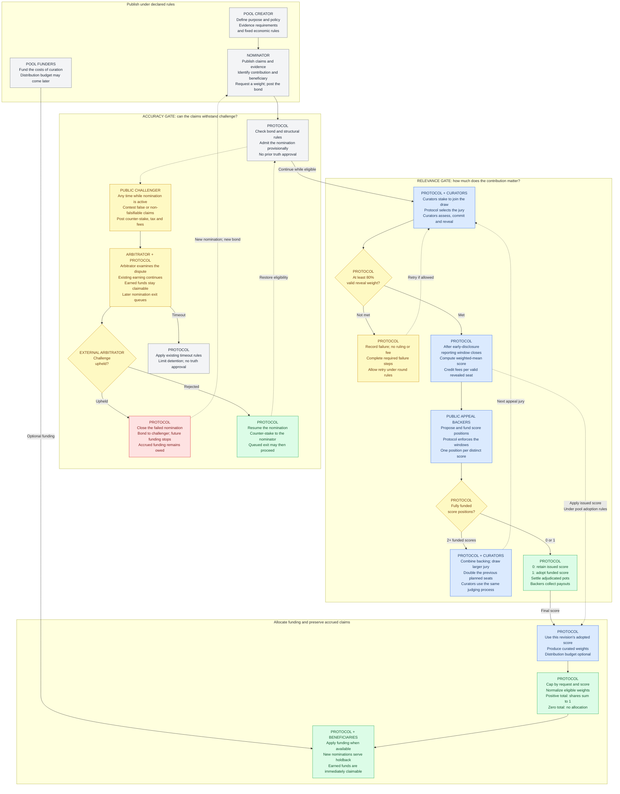

# Public-goods funding (PGF)

_An application of the Decentralized Curation framework._

This one-page workflow shows the ongoing-funding application used in the presentation. Its accuracy gate controls nomination eligibility; its relevance gate supplies policy-relative weights before any beneficiary budget is required. Eligible weights can be normalized into allocation shares; any later funding can use them. These two gates describe this application, not the full scope of the framework. Other funding profiles can have different allocation rules.

Curation and beneficiary funding are separate. Raw effective weights need not sum to one. For each eligible nomination, normalize its effective weight by the positive total to obtain its allocation share. These shares sum to one; an available or later beneficiary budget multiplies them. With no positive eligible weight, there is no allocation vector. Holdback affects earning eligibility, not whether scores can be curated. Curation costs must be funded. The budget distributed to beneficiaries is optional upfront and may arrive later. Bonds, jury-service funding and appeal backing retain their own requirements.

## Actors

Each node begins with its responsible actor. Protocol denotes enforced rules that execute when called; it is not a person, an autonomous evaluator or a substitute for the jury. Pool creators define terms; funders supply capital; nominators post claims and bonds; curators assess relevance; public backers fund appeals; challengers contest factual claims; external arbitrators decide those disputes; beneficiaries claim eligible accrued funding. These roles may overlap.

## Reading the gates

**Accuracy is optimistic and remains challengeable.** Its initial path does not certify truth or require a pre-publication reviewer. A factual challenge can begin at any time while the nomination is active, including before its first relevance score and during a relevance assessment or appeal. A withdrawn nomination is inactive and cannot receive a new challenge. Debunking is nomination-specific: the author may submit a fresh nomination with a new bond under ordinary rules; all funding earned before closure remains owed, whether already paid or still unclaimed. The forfeited nomination bond is separate from those earnings.

**Relevance is scalar.** The jury applies the declared policy; it does not certify factual truth. Quorum needs a nonempty draw and valid timely reveals covering at least 80% of the original drawn weight. Drawn attempts complete the fixed early-disclosure reporting window after the reveal deadline and before issuance or failure settlement. This window allows qualifying evidence of premature score disclosure to be submitted and validated. Appeal quorum failures permit unlimited same-target retries; ordinary retries follow the pool's rules.

**Appeal outcomes and money.** At least two fully funded distinct scores share one jury and pot, once admission closes and all funding outcomes are known. With none funded, the old score stands and partial contributions are refundable. With one funded, its score wins by forfeiture, with a full refund and no jury fee or profit on that position; forfeiture is not consensus. Each adjudicated pot settles at chain finality against the ultimate final score, net of any jury-fee shortfall. Payout weights use inverse distance; a unique exact prediction receives the net pot. Backers split their position's payout pro rata. Earned jury service fees become claimable at issuance, separately from locked backer pots.

**Funding and later correction.** The pool's adoption rules determine when this nomination revision's score affects funding; score adoption is separate from final settlement of appeal backer pots. Effective funding weight is the lower of requested weight and the adopted score. Eligible positive weights divide the distributable flow proportionally; a sole eligible positive weight receives the full flow. A permitted later relevance assessment re-enters the relevance gate and can change future funding. A factual closure stops the nomination's future earning eligibility without erasing its accrued funding, relevance history or an already protected contested appeal chain. Its beneficiary can immediately claim accrued funding, including while an accuracy dispute is pending and after debunking. Holdback applies only to new nominations before earning starts; later rating changes create no new holdback, and earned money is never locked by holdback. Later relevance outcomes cannot restore a closed nomination's eligibility. Detailed withdrawal, fork-recovery, revision and payment-rounding rules are outside this overview.

**Nomination withdrawal.** A withdrawal of the nomination is an exit, not a claim on earnings. If requested after an accuracy dispute starts, it queues behind that dispute. If the dispute debunks the nomination, the queued exit is cancelled because the nomination has already closed. If the challenge is rejected, the queued exit may proceed under the ordinary rules. Earned-funding claims remain available throughout.

**Assets.** A dedicated utility token backs juror availability, incoherence penalties and coherence rewards. Rewards redistribute penalties without minting. Ether (ETH) pays jury service and supplies the other financial flows.

## Scope and sources

This is the intended ongoing-funding application of Decentralized Curation, not a complete framework diagram or a claim that the rules are deployed, audited or economically validated. The hosted workshop demonstrates scoring only. Agreement is not proof of truth or public benefit. The working paper's retroactive batch-funding profile is outside this flowchart.

The diagram follows the working presentation's source register and likely-questions notes. The public [mechanism and evidence summary](https://decentralized-curation.0xferit.workers.dev/mechanism/) explains the audience-facing scope. Solid navy arrows show the main sequence. Amber arrows show challenge and decision branches. Dashed purple arrows show returns or conditional paths. Teal shows pool-budget funding. Arrowheads mark destinations; a crossing without a dot is not a junction.
